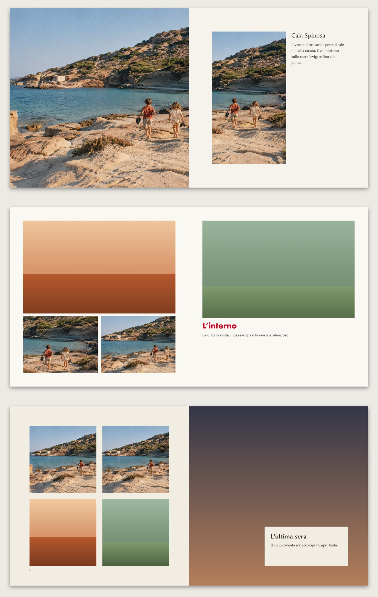

# Paper & Grain

[](https://github.com/magno73/PaperAndGrain/actions/workflows/ci.yml)

Paper & Grain is a native Mac app that turns a travel album into a printed photobook. It mixes photos and stories, film looks and editorial page templates. It also exports print-ready PDFs.

It is written in SwiftUI. Photo access uses PhotoKit, photo analysis uses Vision and the PDF output uses Core Graphics and Core Text. Everything runs on your Mac: photos are copied into the book and analysed locally, and nothing is uploaded. The interface is available in English and Italian; choose the language in **Settings** (⌘,).

> **Status:** a working prototype that is used to build real books. It has been run on macOS 27; macOS 14, 15 and 26 are supported but not yet tested. Expect rough edges, and check every PDF with your print shop before ordering.

## Features

- **Start from an album.** Pick an album in Photos, or files in Finder. Choose a book size from 21 common photobook formats or a custom one. A first draft is laid out in shooting order.
- **Twelve book templates in three families.** **Classics**, **Studio** and **Photobook**, the last drawn from award-winning photobooks. A template sets paper, type, margins, page rhythm, cover and spine.
- **Page layouts.** An automatic gallery, fixed layouts with margins or full bleed, full spreads and text-over-photo pages. Photos, text boxes and stories can be moved, resized, cropped, aligned with guides and stacked in front of or behind each other.
- **Stories.** Write next to your photos. **Suggested photos** finds pictures that match the text, using on-device labels in English and Italian.
- **Photo editing.** Auto enhance, light, color, black & white, detail, curves, levels and selective color. Film looks: built-in presets, 14 film-emulation LUTs and your own `.cube` or HaldCLUT files, for the whole book or a single photo.
- **Print output.** A proof PDF, a generic print PDF with bleed (`Interior.pdf` and `Cover.pdf` with spine) and print-service profiles that follow a printer's product, today Pixartprinting's 21 × 21 cm hardcover. A preflight check flags photos below the target resolution and, for a print service, sizes and page counts the product does not take.
- **Command line.** A CLI to build, analyse, edit and export books from JSON, so scripts and AI agents can work on a book.



*Spreads exported by the app with the Monograph, Postcard and Kodachrome templates, using the sample photo and synthetic images.*

## Download

Get the latest `Paper-and-Grain-<version>.zip` from [Releases](https://github.com/magno73/PaperAndGrain/releases), unzip it and move **Paper & Grain** to your Applications folder. The app runs on Apple silicon and Intel Macs with macOS 14 or later.

The app is signed but **not notarized by Apple**, so macOS blocks it the first time:

- **macOS 15 and later:** open the app once and close the warning. Then go to **System Settings › Privacy & Security**, scroll to the message about Paper & Grain and click **Open Anyway**.
- **macOS 14:** Control-click the app in Finder, choose **Open**, then **Open** again.
- **Terminal alternative:** `xattr -dr com.apple.quarantine "/Applications/Paper & Grain.app"`.

Each release lists the SHA-256 of the zip, so you can check the download with `shasum -a 256`.

## Requirements

- **To run:** macOS 14 Sonoma or later, Apple silicon or Intel. On macOS 26 and later the panels use Liquid Glass.
- **To build:** Xcode 26 or later (the macOS 26 SDK). The app is developed with Xcode 27.

## Build and run

From the repository root:

```sh
./scripts/build-app.sh            # optimized universal build (Apple silicon and Intel)
./scripts/build-app.sh debug      # faster build for development
open ~/Applications/"Paper & Grain.app"
```

The script builds the executable, bundles resources and translations, signs the app locally and copies it to **`~/Applications/Paper & Grain.app`**. Every build replaces that copy, so the latest one is always in the same place. A versioned copy also stays in `dist/<version>/`. Set `PAPERGRAIN_INSTALL_DIR` to install somewhere else. `scripts/package-release.sh` makes the release zip.

The bundle identifier is `me.magno.paperandgrain`; drafts live in `~/Library/Application Support/PaperAndGrain`. Use the bundle, not `swift run`, when you test access to Photos: macOS grants that permission to the signed app.

Run the tests with:

```sh
swift test
```

`scripts/publish-github.sh` publishes the current branch to GitHub as `main` (add `--tag v<version>` to tag a release; `scripts/github-release.sh` then creates the GitHub Release with the zip). On a temporary copy it replaces the author email with the GitHub noreply address and drops the files listed in `removed_paths` from every commit, so the local history is left untouched. Run it with `--force` once after adding a path.

## Make your first book

1. Choose **New Book from a Photos Album** and allow access when macOS asks. Pick **Recents**, **Favorites** or one of your albums, select the pictures, set the size and press **Auto-Layout**. **New Book from Finder Files** works without Photos. **Open the Sample Book** needs no permissions at all.
2. A new book opens on the **Book Templates** chooser. **Apply** sets paper, type and margins. **Cancel** keeps the basic style. You can change the template later from **Style** in the toolbar.
3. Arrange the pages. Drag photos from the **Photo Library** tray at the bottom onto a page, drag thumbnails in the **Pages** sidebar to reorder pages, and pick a layout with **Layout** in the toolbar.
4. Select a heading, story or text box to write and format it. Select a photo to adjust it or give it a film look.
5. Choose **Save Project** to keep a `.papergrain` package, then **Export PDF** or **Export for Print**.

## The window

| Area | What it does |
|---|---|
| **Pages** (left, ⌃⌘S) | Spread thumbnails. Drag to reorder; hover between pages for **+**; right-click to insert, duplicate, move or delete. After clicking a thumbnail, ← → step one page and ↑ ↓ one spread. Drag the edge to make thumbnails larger. |
| **Toolbar** | **Insert**, **Style** (book template), **Layout** (page layout), **Film**, **Issues**, **Export**, **Photo Library** and **Inspector**. Click the book title for **Book & Print**, templates, saving and exporting. |
| **Canvas** | One page or a spread (⌘1, ⌘2), zoom (⌘+, ⌘−, ⌘0). When the whole page fits, scroll or swipe to turn pages. **Browse the Book** (⌥⌘↩) shows the book full screen. |
| **Photo Library** (bottom, ⌥⌘L) | Thumbnails in each photo's own proportions. Filters **All**, **Unused** and **On Page**, sorting by date, place or subject, a theme filter and search. Drop files from Finder or Photos here, or choose **Import Files…** from its menu, to add them to the open book. |
| **Inspector** (right, ⌥⌘I) | Tabs follow the selection. **Page** or **Cover**. **Text** for a heading, story, box or cover text. **Photo** for a selected photo, cover photo included. **Film** for the book look when no photo is selected. |

The app frame follows the Mac's light or dark appearance. Pages always keep their template colors.

## Laying out pages

- **Select and move.** A click selects the topmost object. Click blank paper, or press Esc or ⇧⌘A, to deselect. Arrow keys nudge the selection by 1 pt, or 10 pt with ⇧. Delete removes it from the page, and ⌘Z brings it back.
- **Page layouts.** **Page › Page Layout…**, or **Layout** in the toolbar, is the single control for the page type. **Automatic gallery** arranges the photos for you. Fixed layouts, with margins or full bleed, place frames, and **Full Spread** fills both pages. Photos that do not fit a layout stay listed on the page until there is room.
- **Photos.** Drag a photo from the tray onto a photo on the page to replace it. It keeps the same slot and layer and is never cropped without telling you:
  - with similar proportions, it fills the same frame;
  - an automatic gallery lays the page out again for the new proportions;
  - in a fixed layout, or a frame you placed by hand, the frame shrinks to the whole photo and nothing else moves;
  - a full-bleed slot is filled, and a note says the photo was cropped.

  Drag a photo onto an empty slot to fill that slot, or onto an empty page to start its layout. Anywhere else it gets a free frame where you drop it. Use the corner handles to resize, even past the trim. Double-click to crop, then press **Done**. Drop a photo inside another one to swap them; hold ⌥ to overlap freely instead. Guides show alignment with the edges and centers of other objects and of the page. Snapping happens while you drag: the photo jumps to the guide and stays where you see it when you let go. The page edges pull a little harder, so a photo brought close to the trim lands exactly on it. Keep dragging past the pull to place it freely, or hold ⌥ to ignore all guides.
- **Resolution.** A photo whose print resolution falls below the book's target (300 ppi unless changed in **Book & Print**) shows a warning badge in its corner: orange below the target, red below two thirds of it. Hover the badge for the value; the **Photo** tab shows the print resolution of the selected photo. The value counts the crop and the zoom, like the export preflight.
- **Layers.** Right-click, or Control-click, a photo, box or story for its own menu. It includes **Bring to Front**, **Bring Forward**, **Send Backward** and **Send to Back**. The same commands are in the **Arrange** menu (⇧⌘F, ⌥⇧⌘F, ⌥⇧⌘B, ⇧⌘B). The order is saved and used in the PDF.
- **Text.** **Insert › Text Box** adds a free text frame. **Insert › Page Heading** adds a heading to any page. Drag text to move it; use the side handles for width and the corners for height. Double-click to type on the page. Drag the story's background, or its **Move Story Group** handle, to move heading, story and background together.
- **Duplicate a page.** **Page › Duplicate Page** (⌘D), or the same item in the Pages context menu, puts a copy right after the page and selects it. Text, frames, crops, layers and typography are copied; photos stay the same photos, so a photo can be on both pages. One ⌘Z removes the copy. It is disabled for the front and back cover and while you are typing.
- **Cover.** **Cover**, **First Page** and **Back Cover** open from the Pages sidebar. **Insert › Title Page** adds an opening page with the book title. Both cover faces take a photo and text that you can move, resize and crop.

## Book templates

Choose **Style** in the toolbar, the **Book Template** row in the Page tab, or **File › Book Templates…**:

- **Classics:** Journal, Atlas, Gallery and Essential.
- **Studio:** Swiss Grid, Berlin Notebook and Japanese Interval.
- **Photobook:** Monograph, Postcard, Nocturne, Kodachrome and Road Log. They draw on *The Americans*, *Fernweh*, Luigi Ghirri's *Kodachrome* and *American Surfaces*.

Each template sets paper color, typefaces, margins, the automatic gallery, text-over-photo panels and a cover title scaled to the template. From a spine width of 5 mm, the spine carries the book title. **Show Page Numbers** turns printed folios on or off. [Template notes](docs/templates.md).

## Formatting text

Select a heading, story or text box and the **Text** tab opens, like Keynote's Format panel:

- **Font:** choose a family and style from the fonts installed on your Mac, with a live preview. Favorites and recent fonts are kept.
- **Size:** −, + or type the size in points.
- **Color:** the template's swatches or any color.
- **Alignment** and **Line Spacing.**
- **Box:** a text box can have no background, the paper color or any color, and a border from 0.5 to 12 pt in any color.
- **Reset to Template Style** removes local changes. **Arrange** brings the object to the front or sends it to the back.

Select the cover title or the back cover text to format it in the same tab. Book-wide defaults for headings and body text are in **Book & Print › Book Typography**. The editor, thumbnails and PDF share the same Core Text layout, so what you see is what prints.

## Photo adjustments and film looks

Select a photo. The **Photo** tab groups **Adjust**, **Film** and **Analysis** in sections that start collapsed. The current look is shown next to **Film**.

- **Adjust:** **Auto Enhance** analyses the photo on your Mac and proposes values you can edit. Then come light, color and white balance, black & white, detail and sharpness, noise reduction, vignette, curves, levels and selective color. **Compare with original** shows the untouched file. Adjustments follow the photo everywhere it is used, and into the PDF.
- **Film for one photo:** with a photo selected, a film choice changes **only that photo**. Tick **Change the whole book** to change the book look instead; the photo then follows the book again. **Follow Book** removes a photo's own look.
- **Film for the whole book:** with nothing selected, the **Film** tab sets the look for every photo that follows the book. It also tells you how many photos have their own look, and **Match Book** brings them back.
- **LUTs:** **Choose LUT** lists 14 sRGB film-emulation LUTs by abpy, with descriptive names such as Natural Slide or Street Negative, and imports your own 3D `.cube` or HaldCLUT `.png`. Imported LUTs are copied into the project.

Every look choice or slider drag is a single ⌘Z step.

## Printing

**Book & Print** sets the format, bleed, safe margin, target resolution, PDF type, the side of the first page and the cover with spine width.

**Print service** in **Book & Print** chooses a printer's product and size, or **None (generic print)**. A product sets bleed and safe margin from its specification and lists its rules: page count, margins from the edges and the binding, and what the first and last pages are. If the book's size is not one the product offers, the section lists the product's sizes, closest first, and **Use …** changes the size only when you click it; changing size re-flows the pages. When a printer states a measure only in your quote (spine, hinge, board, bleed), the section has a field for it; one the product computes from the page count shows its value and accepts another. If the book has an odd number of pages for a product that counts in steps, the export adds blank pages at the end, and glued endpapers stay blank. Next to every product the app shows the date the specification was checked, a link to the printer's page and a reminder that Paper & Grain is not affiliated with the printer: check the printer's current requirements before ordering. When you create a book from an album, the size menu can show only the sizes of one print service.

- **Export for Print** writes `Interior.pdf` and, if enabled, `Cover.pdf`. It flags photos below the target resolution and the filler pages that panoramas need.
- **Issues** (⇧⌘I, or the toolbar button next to **Export**, a triangle or, when something blocks the export, an octagon) runs the same preflight check while you work, a moment after your last change, and shows the number of problems and warnings; a check mark means none. The popover lists problems first, then warnings, under the page they belong to. Click a row to go to the page and select the photo, text box, story or cover face. The list checks the book's print service when one is chosen (size, page count, measures from the quote, and text inside the product's wider margin along the binding), otherwise Generic Print.
- Before an export, a preflight check lists what would stop it, such as text that overflows its frame or a missing photo file, and the warnings, such as low resolution. Problems must be fixed before you can continue; warnings can be ignored.
- **Export PDF** offers **Viewing PDF**, **Generic Print**, the book's print service if it has one, and **Other print service…**, which picks any product in the catalog. A product's measures from your quote have fields there too; what you type for the book's own product is kept in the book. The Pixartprinting 21 × 21 cm hardcover writes one 1:1 PDF: a flat hardcover with the spine width from your quote, then single 216 × 216 mm pages with 3 mm bleed. PDFs are sRGB and are not certified PDF/X.

**Print guides.** **View › Show Print Guides**, or **Print Guides** in the zoom menu on the canvas, draws on every interior page a dashed line at the safe margin and a thin line at the bleed, outside the page. The choice is kept between launches, and a short legend appears the first time it is turned on in a session. The guides are only on the canvas: thumbnails, **Browse the Book** and the PDFs never show them. Changing **Safe margin** or **Bleed** in **Book & Print** moves the lines. Two warnings in **Issues** use the same lines: text whose frame crosses the safe margin, and a photo edge that stops less than the bleed inside the page edge (the message gives the distance), where a small cutting error would show paper. The edge on the binding side is not checked. The cover faces get no guides, and neither they nor the viewing PDF are checked.

Always use the exact dimensions and color requirements of the product you order.

## Help and about

**Help › Paper & Grain Help** (⌘?) opens a short guide in the interface language. **Paper & Grain › About Paper & Grain** shows the author, Marco Magnocavallo ([marco@magno.me](mailto:marco@magno.me)), the license and the source repository.

## Command line

The app binary includes a CLI. It can build a book from a JSON spec, list and search photos, apply patches, create variants, import LUTs and export PDFs:

```sh
swift run PaperAndGrain cli build trip.json Trip.papergrain
~/Applications/"Paper & Grain.app"/Contents/MacOS/PaperAndGrain cli export-pdf Trip.papergrain --profile print --output Trip.pdf
```

See the [CLI guide](docs/cli.md) for every command and the JSON formats.

## Privacy and project files

- **Photos:** selected photos are copied into the book. Photos may download originals from iCloud when they are needed.
- **Analysis:** Vision runs on the Mac on copies of up to 640 pixels. Labels and themes are stored in the project.
- **Drafts and packages:** a new book starts as a draft in your user's Application Support folder, and the welcome window lists every draft. Right-click a draft and choose **Delete Draft…** to move it to the Trash; after **Save As**, the draft moves to the Trash too. A saved `.papergrain` package holds the images, the analysis and the document; share it only as you would share the original album.
- **Saving:** a book renamed or moved in Finder while open keeps saving in its new place. If it disappears, use **Save As** to keep your changes. A book saved by a newer version of the app, or stored in a read-only location, opens read-only; **Save As** makes an editable copy of a book in a read-only location.
- **This repository:** it contains only synthetic or authorised test images. Keep personal albums, local projects and private text out of Git.

## Documentation

- [CHANGELOG.md](CHANGELOG.md): what changed in each version.
- [CONTRIBUTING.md](CONTRIBUTING.md): how to build, test and propose a change.
- [AGENTS.md](AGENTS.md): instructions for people and coding agents working on the code. Entry points, how to work in increments and how to verify changes.
- [Architecture and document format](docs/architecture.md)
- [Status](docs/status.md): what has been tested, what has not, and known limitations.
- [Templates](docs/templates.md)
- [CLI](docs/cli.md), [editing commands](docs/cli-editing.md) and [media commands](docs/cli-media.md)

## Licensing

The film-emulation LUTs in `Resources/FilmLooks` come from [FujifilmCameraProfiles by abpy](https://github.com/abpy/FujifilmCameraProfiles). They are licensed under [CC BY-NC-SA 4.0](https://creativecommons.org/licenses/by-nc-sa/4.0/), which forbids commercial use; see [CREDITS](Resources/FilmLooks/CREDITS.md) for the original file of each look. The app names the looks descriptively and uses no film or camera trademark. The fonts are the ones that ship with macOS. Check their embedding license before you sell printed books.

The source code is available under the [PolyForm Noncommercial License 1.0.0](LICENSE). You may use, study, modify and share it for any noncommercial purpose: personal projects, research, education, nonprofits. Selling the app or using the code in a commercial product is not allowed. For commercial licensing, write to [marco@magno.me](mailto:marco@magno.me). The bundled LUTs keep their own license, described above.
